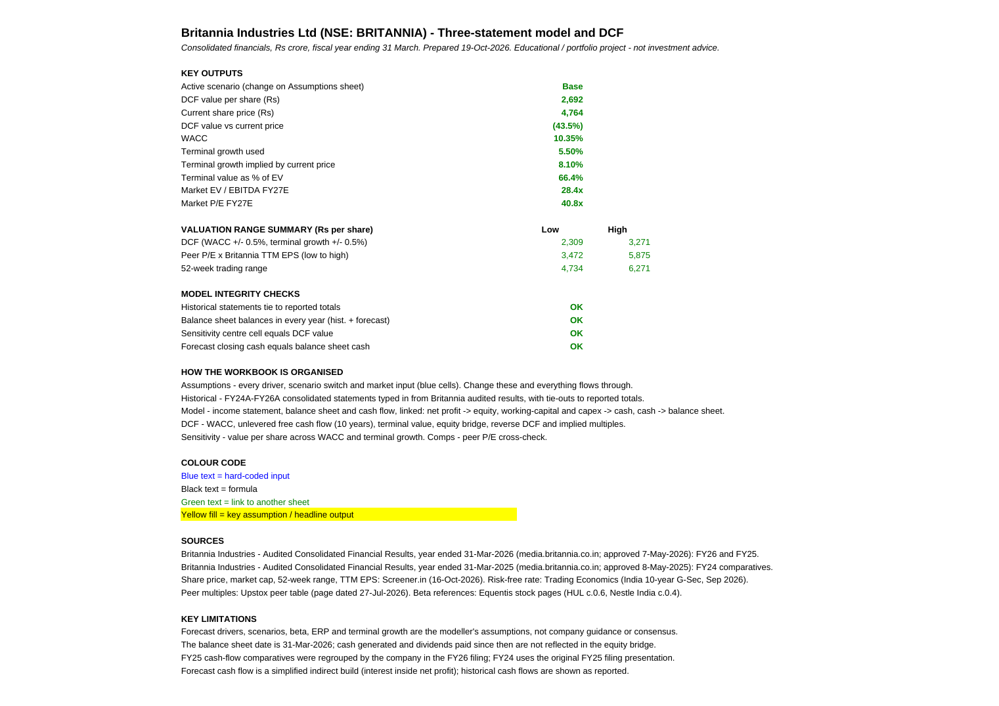
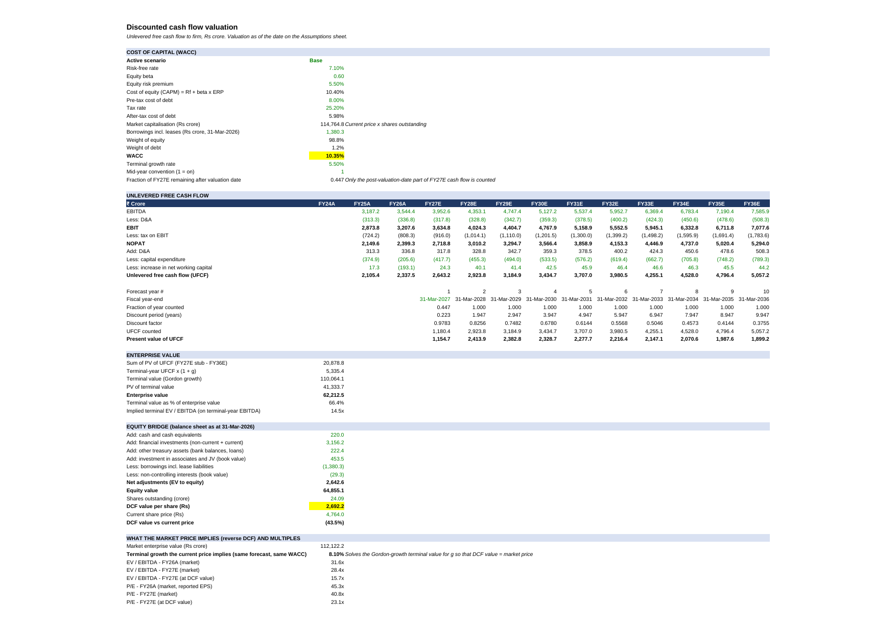
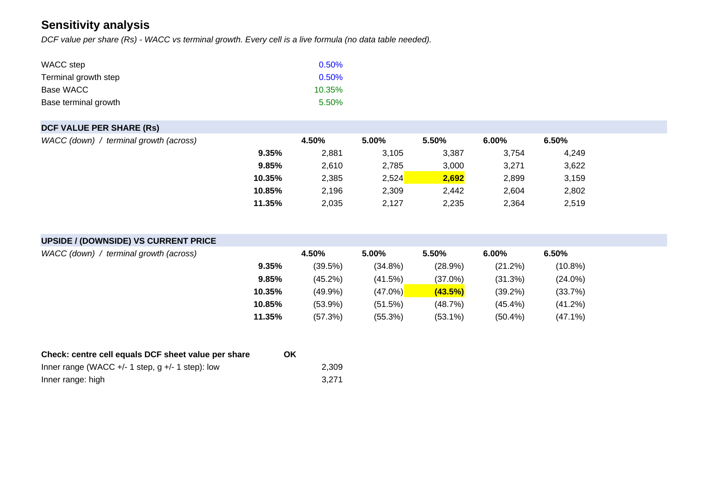

# Britannia Industries (NSE: BRITANNIA) - Three-Statement Model and DCF

An Excel model of Britannia Industries Ltd: an integrated three-statement forecast (FY27E-FY36E) feeding a 10-year unlevered DCF, with bear/base/bull scenarios, a sensitivity table, a reverse DCF and peer P/E comps.

**File:** `Britannia_3Statement_DCF_Model.xlsx`

## Preview (no download needed)
A 3-page PDF of the key sheets is in this repo: [Britannia_Model_Summary.pdf](Britannia_Model_Summary.pdf).

**Summary sheet: key outputs, valuation range and integrity checks**

**DCF sheet: WACC, 10-year free cash flow, terminal value, equity bridge and reverse DCF**

**Sensitivity sheet: value per share across WACC and terminal growth**

## Sheets
| Sheet | What it does |
|---|---|
| Cover | Key outputs, valuation range summary, integrity checks, sources, limitations |
| Assumptions | Every forecast driver, the scenario switch (1 = Bear, 2 = Base, 3 = Bull) and market inputs |
| Historical | FY24A-FY26A consolidated statements from Britannia's audited results, with tie-outs to reported totals |
| Model | Linked income statement, balance sheet and cash flow; the balance sheet balances in every year |
| DCF | WACC (CAPM), unlevered free cash flow, mid-year discounting, Gordon-growth terminal value, equity bridge, reverse DCF, implied multiples |
| Sensitivity | DCF value per share across WACC and terminal growth (live formulas) |
| Comps | Peer P/E cross-check (HUL, Varun Beverages, Marico, Godrej Consumer) |

## How to use
Change the scenario or any blue input on the **Assumptions** sheet; every sheet updates. Blue = input, black = formula, green = link to another sheet, yellow = key assumption.

## Base-case result (illustrative)
The base case values the shares below the market price, and the reverse DCF shows the terminal growth the market price implies. This reflects deliberately conservative assumptions, not a recommendation.

## Sources
- Britannia audited consolidated results for FY26 (approved 7 May 2026) and FY25 (approved 8 May 2025), media.britannia.co.in
- Share price, market cap, TTM EPS and 52-week range: Screener.in, 16 Oct 2026
- India 10-year G-Sec yield: Trading Economics
- Peer multiples: Upstox peer table dated 27 Jul 2026

## Limitations
Forecast drivers, beta, equity risk premium and terminal growth are the author's assumptions, not company guidance or consensus. The balance sheet date is 31 Mar 2026. Market inputs should be refreshed before use. Educational project, not investment advice.
